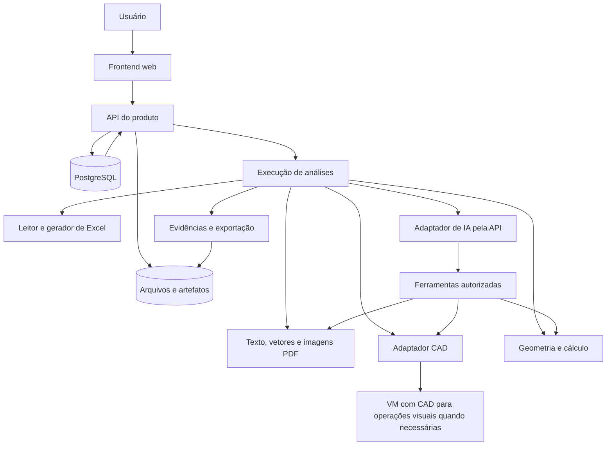

# BuildCalc AI — arquitetura proposta

Data: 05/11/2026. Natureza: especificação técnica para orientar decisões e entregas incrementais. Este documento não declara componentes instalados, integrações implementadas nem escolha definitiva de fornecedor.

O produto combina interpretação de serviços e projetos por IA com ferramentas de leitura, medição, cálculo e publicação. Cada entrega deve permitir ao usuário reconhecer a parcela física considerada, a origem da medida, as premissas e a fórmula que produziu a quantidade.

O PRD define o comportamento do produto. Os procedimentos em `procedimentos-orcamento/` definem a referência técnica reutilizável. O Beads mantém tarefas, dependências, decisões e andamento; este documento não é um backlog paralelo.

## 1. Princípios e limites

- Construir fatias verticais: cada etapa entrega uma interação do frontend, sua operação no backend e um resultado verificável pelo usuário.
- A primeira fatia recebe um Excel e apresenta seus serviços. Ela não exige IA, processamento CAD, computador remoto nem cobrança.
- Preservar arquivos recebidos e separar os dados originais de interpretações, medições e quantidades levantadas.
- Definir contorno, trecho, ponto ou conjunto antes da conta. Uma quantidade deve apontar para parcelas identificadas, não somente para uma página de projeto.
- Usar o mesmo conjunto de parcelas na fórmula e na evidência visual. Uma revisão de geometria invalida a evidência anterior até sua atualização.
- Tratar escala, unidade, transformações e níveis como dados rastreáveis. Ausência de cota escrita não impede medir geometria válida; ausência de escala confiável ou de uma dimensão não representada impede afirmar aquela medida como conhecida.
- Distinguir estados de processamento, suficiência da quantidade e revisão humana. Conclusão de um processo não equivale a aprovação técnica.
- Tornar os serviços externos e os motores CAD substituíveis por adaptadores. A identificação de um motor que abre o arquivo não comprova que ele extraiu todas as entidades necessárias.

## 2. Topologia inicial proposta



Uma VM de desenvolvimento e processos locais são suficientes para validar as primeiras fatias. Kubernetes é uma alternativa futura de operação e escala, não uma condição de início. A necessidade de uma sessão gráfica persistente deve ser tratada separadamente da hospedagem da API web.

### Componentes candidatos

| Componente | Proposta inicial | Motivo e condição de decisão |
|---|---|---|
| Frontend | Next.js/React com TypeScript | Formulários, navegação da obra, tabela de serviços e posterior visualizador. Confirmar durante o início técnico. |
| API | FastAPI com Python | Integração com extração de documentos e motores de geometria; contratos tipados. |
| Banco | PostgreSQL | Dados relacionais de obras, revisões, serviços, parcelas, resultados e permissões. |
| Arquivos | Diretório protegido no desenvolvimento; storage compatível com S3 quando houver ambiente compartilhado | Separar binários grandes do banco e permitir acesso controlado. |
| Excel | Adaptador Python de leitura e adaptador de exportação a validar | Ler todas as linhas necessárias e preservar conteúdo e recursos contratados. Bibliotecas e estratégia de recálculo dependem de avaliação. |
| CAD | Adaptadores candidatos LibreDWG, ACadSharp e/ou motor comercial | Escolha depende de fidelidade, recursos necessários, ambiente e licença. Um processo .NET separado pode hospedar ACadSharp se selecionado. |
| DXF | Adaptador candidato `ezdxf` | Trabalhar com entidades e representações DXF; a origem DWG requer leitor ou conversor próprio. |
| PDF | Extração de texto/vetores, renderização e OCR quando necessário | Tratar separadamente PDF vetorial e imagem digitalizada. |
| IA | Adaptador de API com ferramentas e resultados estruturados | Manter modelo, versão, instruções e limites identificados por execução. |
| Trabalho demorado | Processo de execução isolado; fila quando a duração/concorrência justificar | Evitar requisições web longas e permitir retomada, cancelamento e limites. Não instalar infraestrutura de fila antes da fatia que a utiliza. |
| CUA | Serviço de execução em VM com CAD e sessão gráfica persistente | Oferecer capturas, ações e resultados reais ao modelo; não é uma VM automaticamente fornecida pela API de IA. |

Nenhuma decisão de biblioteca deve depender de pacotes privados ou do ambiente interno usado nos testes em chat. O produto precisa de dependências redistribuíveis/contratadas, instalação reproduzível e operação própria.

## 3. Domínio e dados principais

| Entidade | Conteúdo essencial |
|---|---|
| Organização e usuário | Identidades, vínculos e papéis; limites do cliente. |
| Obra | Nome, configurações, disciplinas autorizadas e unidade de trabalho. |
| Arquivo recebido | Identificador opaco, nome recebido, tipo detectado, tamanho, hash, organização, obra e retenção. |
| Revisão de documento | Arquivo original, revisão indicada pelo projeto, data indicada, relação com versões anteriores; nome de arquivo não decide sozinho a revisão válida. |
| Representação | Página PDF, região do Model, layout, viewport ou combinação de camadas; transformação para a origem. |
| Importação Excel | Arquivo de origem, abas, dimensões lidas, fórmulas, células e falhas de leitura. |
| Serviço de origem | Aba, linha/célula, identificador recebido, descrição, unidade, quantidade original e hierarquia; identidade estável mesmo se a descrição se repetir. |
| Escopo | Seleção explícita de abas/serviços/disciplinas, versão e autor da decisão. |
| Elemento de projeto | ID da entidade, geometria/texto/bloco, representação, camada e vínculo com o arquivo original. |
| Seleção de medição | Elementos/contornos considerados, inclusões, deduções, pavimento, unidade, coordenadas e decisão do usuário/IA. |
| Premissa | Valor/unidade ou regra, origem, justificativa, versão, responsável e parcelas dependentes. |
| Parcela | Grandezas de entrada, fórmula, critério, método de medição e vínculos com seleções/fontes. |
| Resultado de serviço | Quantidade ou subtotal conhecido, unidade, estado técnico, dependências e memória. |
| Evidência | Imagem/recorte real, marcações, IDs das parcelas, transformações, hashes e versão do cálculo. |
| Revisão humana | Autor, decisão, alterações, comentários e versão aprovada. |
| Execução | Tipo de processo, entradas/versionamento, estado operacional, tentativas, consumo e artefatos. |
| Exportação | Snapshot das versões usadas, arquivo final, validações e vínculo com memórias/evidências. |

O identificador do serviço não deve ser apenas a numeração comercial: duas abas podem conter `03.06`, ou um mesmo item pode aparecer repetido. Usar um ID interno associado ao arquivo, à aba e à linha de origem, mantendo a numeração recebida para apresentação.

### Separação de estados

| Dimensão | Exemplos propostos | Significado |
|---|---|---|
| Processamento | `queued`, `running`, `waiting_for_input`, `succeeded`, `failed`, `cancel_requested`, `cancelled` | O que o software está executando. |
| Resultado técnico | `not_measured`, `confirmed`, `estimated`, `partial`, `pending`, `not_applicable`, `engineering_definition` | Suficiência da quantidade e natureza da base. |
| Revisão | `unreviewed`, `in_review`, `approved`, `changes_requested` | Decisão humana sobre determinada versão. |

O mapeamento de apresentação é `not_measured` → Não levantado; `confirmed` → Confirmado; `estimated` → Estimativa; `partial` → Parcial; `pending` → Pendente; `not_applicable` → Não aplicável; `engineering_definition` → A definir pela engenharia. `confirmed` exige base suficiente para o alcance declarado, mas não representa aprovação humana automática nem certificação de projeto. O método efetivo da parcela continua em campo próprio. Uma alteração de entrada torna a aprovação da versão anterior histórica e exige nova revisão do resultado afetado.

## 4. Contrato de leitura do Excel

O primeiro leitor deve percorrer a planilha por código, sem depender de resumos automáticos ou de uma amostra limitada de linhas enviada ao modelo.

O adaptador retorna:

- Abas existentes, visibilidade, intervalos utilizados e informações de células mescladas.
- Endereços e tipos das células necessárias para localizar serviços, unidades e quantidades.
- Valores literais, texto de fórmulas e valor calculado armazenado, quando presente, como campos distintos.
- Distinção entre célula vazia, quantidade zero, fórmula sem cache, erro de fórmula e texto.
- Candidatos a cabeçalho e mapeamento de colunas, acompanhados da possibilidade de correção pelo usuário.
- Linhas de título, agrupamento, serviço, subtotal e resumo, sem transformar todas em serviços ou somá-las duas vezes.
- Avisos de formato não suportado, proteção, arquivo corrompido, recursos não preserváveis e limites atingidos.

O usuário confirma o mapeamento e as abas consideradas. Uma aba oculta deve aparecer no inventário com essa condição; isso não a inclui automaticamente no levantamento.

O formato inicial deve ser definido explicitamente, por exemplo `.xlsx`. `.xls`, `.xlsm`, planilhas protegidas e outros formatos entram por decisões específicas. Macros nunca são executadas. Se um formato não for suportado, o produto explica o limite antes de prometer uma exportação fiel.

O arquivo original permanece imutável. A quantidade recebida é referência comparativa, não entrada para ajustar o levantamento. Novos resultados pertencem a campos próprios. Na exportação, preservar as células e recursos fora do alcance contratado; detectar uma perda de recurso é motivo para impedir a publicação daquela exportação ou oferecer uma modalidade de entrega claramente distinta.

Fórmulas novas exigem estratégia de recálculo validada. Gravar o texto de uma fórmula não comprova que seu cache ou suas dependências funcionam no aplicativo de destino. Registrar qual motor efetuou o recálculo e quais verificações foram realmente executadas.

## 5. Leitura e normalização de projetos

### PDF

Separar texto extraído, primitivas vetoriais e imagens da página. O mesmo PDF pode combinar esses conteúdos. A representação precisa manter número de página, dimensões, rotação e transformação entre coordenadas PDF, pixels e unidade física calibrada.

As medidas de um PDF só usam escala validada por informação confiável da representação. OCR e interpretação visual podem localizar cotas e notas, mas não criam precisão geométrica ausente. Digitalizações, baixa resolução, distorção e páginas redimensionadas devem receber tratamento próprio. A indicação de escala no carimbo não dispensa verificar se corresponde à página/vista efetiva.

### DWG/DXF

Inventariar Model, layouts, viewports, camadas, blocos, inserções aninhadas, atributos, referências externas e entidades não suportadas. Manter matrizes de transformação, unidade declarada e validação de unidade. O processo deve reconhecer representações repetidas do mesmo elemento antes de agregar quantidades.

Cada adaptador retorna dados normalizados e um relatório de cobertura. Entidade ignorada, proxy, referência ausente ou bloco não resolvido não pode desaparecer silenciosamente. Não usar uma conversão que perde o elemento como evidência de que ele não existe no original.

Ler as coordenadas diretamente é uma possibilidade de medição. Operar um comando do aplicativo é outra. A origem da grandeza deve distinguir `project_label`, `dimension_calculation`, `coordinate_calculation`, `native_command` e `calibrated_graphical_estimate`. A interface não deve apresentar cálculo por coordenadas como comando nativo executado.

### Contrato normalizado de elemento

```json
{
  "element_id": "elemento-interno-estavel",
  "source_revision_id": "revisao-documento",
  "representation_id": "vista-layout-ou-pagina",
  "source_entity_id": "handle-ou-id-quando-existente",
  "kind": "polyline",
  "layer": "nome-da-camada",
  "coordinate_system_id": "sistema-identificado",
  "transform_to_source": "referencia-da-matriz",
  "geometry_ref": "artefato-geometrico",
  "coverage_status": "supported",
  "provenance_ref": "registro-de-extracao"
}
```

Esse exemplo é um contrato proposto, não um resultado de extração nem uma API já disponível.

## 6. Ferramentas de IA e execução visual

O backend fornece ferramentas com contratos explícitos: ler serviços, pesquisar fontes, listar representações, obter entidades, renderizar recorte, propor seleção, validar contorno, calcular parcelas e gerar memória. Cada ferramenta limita os arquivos, obras e operações que pode acessar.

O modelo recebe o serviço, o escopo autorizado, o procedimento pertinente e as fontes necessárias. A execução conserva chamadas e resultados para permitir retomada e auditoria. A janela de contexto do modelo não substitui o banco da obra.

### Computer use em VM

O serviço de execução deve abrir uma sessão isolada de CAD, capturar a tela, executar ações permitidas e devolver observações reais ao modelo. A API de IA fornece a interpretação e solicita ações; nossa infraestrutura fornece o aplicativo e sua sessão.

Fluxo proposto para uma área sem cota escrita:

1. Abrir a cópia identificada do desenho na representação correta.
2. Conferir unidade e contexto da vista.
3. Selecionar um contorno existente ou produzir um contorno de conferência.
4. Executar a medição disponível no aplicativo e capturar o resultado.
5. Associar comando, seleção, unidade, arquivo e evidência à parcela.
6. Conferir o contorno e suas deduções antes de incorporar a quantidade.

Uma VM gráfica atende uma sequência de operações por vez; múltiplos agentes não compartilham mouse e foco simultaneamente. Sessões devem ter limites, cancelamento, limpeza de arquivos temporários e fechamento dos documentos da tarefa. O aplicativo precisa oferecer as operações necessárias: a presença de um visualizador não garante edição de contornos, acesso a entidades ou exportação.

O CAD Reader é um candidato de operação visual a avaliar, não uma integração confirmada. Testar instalação compatível, medição, captura, exportação, estabilidade e condições do fornecedor. Uma API pública dele não foi confirmada nesta especificação.

## 7. Motor de geometria e cálculo

O motor valida geometrias antes da aritmética: fechamento, autointerseção, arcos, vazios, transformações, plano/Z e unidade. Correções automáticas de tolerância devem registrar o que foi alterado; não deslocar vértices para coincidir com uma etiqueta do projeto.

Separar a geometria base da aplicação por serviço. O mesmo ambiente pode servir a piso, forro e pintura com limites diferentes. Para paredes, identificar faces, alturas, vãos, retornos e partes existentes. Para elétrica, separar percurso horizontal, vertical, vias físicas, condutores por função/seção, reservas e componentes incluídos em pacotes.

Entradas numéricas e regras formam um grafo de dependências. Alterar altura, contorno, premissa ou revisão invalida os resultados, evidências e aprovações dependentes. Parcelas independentes continuam válidas. Campo obrigatório ausente resulta em pendência ou subtotal identificado, sem converter ausência em zero.

Usar unidades explícitas e precisão adequada à origem. Coordenadas podem exigir ponto flutuante; totais apresentados e critérios de arredondamento precisam de política própria. A precisão computacional não implica precisão física. Aproximações de curvas precisam de tolerância registrada.

## 8. API do produto — contratos iniciais propostos

Rotas são ilustrativas e deverão ser consolidadas com o frontend da respectiva fatia.

BC-01 pode começar sem plataforma de obras: `POST /spreadsheet-imports` recebe o XLSX e cria uma importação temporária local; `GET /spreadsheet-imports/{import_id}/sheets` e `GET /spreadsheet-imports/{import_id}/rows` retornam abas/células. BC-02 acrescenta `PUT /spreadsheet-imports/{import_id}/mapping`, conservado durante a importação para recarga do navegador. Em BC-03, `POST /projects/{project_id}/spreadsheet-imports/{import_id}/attach` associa essa importação à obra persistida e a retomada passa a sobreviver ao reinício do backend. As rotas com `project_id` abaixo representam o contrato consolidado, não pré-requisitos para a primeira tela. Importações temporárias continuam limitadas ao uso local; não recebem exposição externa sem autenticação/isolamento.

| Operação | Exemplo de endpoint | Resultado esperado |
|---|---|---|
| Criar obra | `POST /projects` | Obra vinculada ao contexto autorizado. |
| Receber arquivo | `POST /projects/{project_id}/files` | Arquivo persistido, hash/tipo detectado e estado de ingestão. |
| Importar Excel | `POST /projects/{project_id}/spreadsheet-imports` | Importação ou execução rastreável, com idempotência. |
| Examinar abas | `GET /spreadsheet-imports/{import_id}/sheets` | Abas, visibilidade e estrutura. |
| Confirmar mapeamento | `PUT /spreadsheet-imports/{import_id}/mapping` | Versão validada das colunas e critérios de linha. |
| Consultar serviços | `GET /projects/{project_id}/services` | Lista paginada, filtrável e associada à origem. |
| Definir escopo | `PUT /projects/{project_id}/scope` | Nova versão da seleção de abas/serviços/disciplinas. |
| Processar documento | `POST /projects/{project_id}/document-analyses` | Execução com cobertura e artefatos de leitura. |
| Consultar execução | `GET /jobs/{job_id}` | Estado, etapa, progresso verificável, limites e erro acionável. |
| Cancelar execução | `POST /jobs/{job_id}/cancel` | Solicitação idempotente; confirmação após o executor parar. |
| Criar/revisar medição | `POST /services/{service_id}/measurement-versions` | Seleções, parcelas, critérios e resultado versionados. |
| Consultar memória | `GET /services/{service_id}/memory` | Memória e evidências da versão selecionada. |
| Registrar revisão | `POST /measurement-versions/{version_id}/reviews` | Decisão sobre uma versão exata, com autor. |
| Exportar | `POST /projects/{project_id}/exports` | Snapshot consistente e arquivo acompanhado de validação. |
| Baixar artefato | `GET /artifacts/{artifact_id}/download` | Download autorizado; sem expor caminho de servidor. |

O backend valida que `project_id`, serviço, arquivo, job e artefato pertencem ao mesmo contexto autorizado. O navegador não escolhe livremente um identificador de organização para obter acesso. Conflitos de versão retornam erro explícito, em vez de sobrescrever edições recentes.

## 9. Processamento, retomada e custo

Começar com execução simples para a primeira importação. Processamentos CAD, OCR e levantamentos completos passam a trabalhos em segundo plano quando introduzidos. O navegador acompanha o progresso por consulta ou eventos, sem manter uma única requisição longa aberta.

Cada execução registra entradas imutáveis, versões de adaptadores/procedimentos, tentativas, consumo, logs e artefatos. Uma chave de idempotência evita duplicação por reenvio do usuário. Falhas transitórias têm tentativas limitadas; falha de interpretação, entidade não suportada e falta de fonte não devem entrar em repetição automática ilimitada.

Criar pontos de retomada nas saídas de leitura, catálogo, base geométrica, memória e exportação. Reusar artefatos somente quando coincidirem hash de entrada, versão de ferramenta, configuração, escopo e permissões. Cache de uma organização não revela conteúdo a outra.

Manter um orçamento de execução por obra e limites por chamada, tarefa, arquivo e sessão gráfica. Registrar tokens/uso retornado pelo provedor, tempo de processamento, storage e operações CAD quando disponíveis. Estimativa inicial de custo e custo efetivo são campos diferentes. Uma tarefa cancelada pode ter consumo já realizado; a política comercial deve representar essa condição.

## 10. Arquivos e proveniência

Estrutura lógica proposta, com IDs opacos:

```text
organizations/{org_id}/projects/{project_id}/
  originals/{file_id}/...
  revisions/{revision_id}/representations/...
  extractions/{extraction_id}/...
  measurements/{measurement_version_id}/...
  evidence/{evidence_id}/...
  exports/{export_id}/...
```

Não usar o nome recebido como caminho executável. O banco guarda as relações; a estrutura física de pastas não substitui o controle de acesso.

Cada evidência registra fonte real, revisão, vista/página, retângulo do recorte, transformação de pixels e coordenadas, marcações, IDs das parcelas e hashes. Uma imagem produzida por IA para ilustrar uma planta não é prova de medição. O produto pode gerar sobreposições gráficas por código sobre a fonte real.

Cada exportação congela as versões dos serviços, premissas, medições e evidências. Uma alteração posterior cria nova versão, sem reescrever a história da entrega anterior. A interface deve permitir chegar da quantidade às parcelas e delas às fontes, e percorrer o sentido inverso.

## 11. Segurança e acesso por cliente

A fase local inicial pode operar apenas no ambiente de desenvolvimento, com acesso restrito. Antes de receber arquivos de clientes externos, implementar autenticação, autorização por organização/obra e isolamento também no storage, filas, sessões gráficas, downloads e logs.

Tratar documentos como dados não confiáveis: limites de tamanho e expansão, validação do tipo real, processamento em ambiente isolado, dependências atualizadas e bloqueio de execução de macros/comandos embutidos. Texto em projeto, planilha ou captura não concede autorização ao agente para alterar escopo, executar shell ou transmitir arquivos.

Referências externas de CAD não autorizam acesso automático a rede, pastas do host ou URLs. Inventariar dependências ausentes e solicitar seu fornecimento pelo fluxo de arquivos da obra. A execução de ferramentas deve usar operações e caminhos permitidos, com tempo e memória limitados.

Segredos de API ficam no servidor. O navegador recebe somente recursos autorizados e respostas necessárias. Logs excluem credenciais e minimizam conteúdo do cliente. Retenção, exclusão e restauração precisam abranger originais, derivados, caches, backups, exports e dados de provedores conforme capacidades contratadas e política definida para o produto.

## 12. Validação de motores e licenças

Avaliar leitura e renderização separadamente. A escolha deve comparar os mesmos arquivos e representações, entidades extraídas, blocos aninhados, referências externas, curvas, textos, camadas, transformações e medidas verificadas. Abertura bem-sucedida e quantidade de entidades semelhantes são evidências parciais, não equivalência completa.

Os candidatos têm licenças e modalidades distintas: LibreDWG declara GPLv3+, ACadSharp e ezdxf declaram MIT; ODA e Autodesk oferecem soluções comerciais. Identificar versões, componentes incorporados, distribuição e modalidade de serviço antes de escolher o motor. Este documento não conclui obrigações jurídicas nem presume que um aplicativo gratuito permita toda forma de automação comercial.

A execução visual por API também deve ser validada com o aplicativo real, medindo sucesso da tarefa, intervenções, tempo, custo e evidências. Comparar essa rota à extração direta nos casos em que ambas conseguirem executar o mesmo serviço.

## 13. Estratégia de verificação

Cada fatia deve ter um exemplo de demonstração e verificações do contrato que ela entrega. Para o Excel inicial: linhas além de amostras curtas, múltiplas abas, cabeçalhos mesclados, fórmulas, vazios, zeros e descrições repetidas. Para as medições: casos conhecidos de corredor, pavimento secundário, vãos, duplicação de representações e mudança de altura.

Validar separadamente leitura, interpretação de escopo, geometria, cálculo, evidência e exportação. Um fechamento aritmético correto não comprova que o contorno físico foi escolhido corretamente. Usar referências conferidas independentemente e registrar as intervenções humanas.

Os arquivos das obras de origem não devem ser copiados automaticamente para um repositório público. Casos sintéticos podem reproduzir seus problemas geométricos e de planilha; uso de documentos reais exige destino, acesso e autorização próprios.

## 14. Fontes técnicas consultadas

As fontes sustentam as possibilidades de integração; nomes de modelos, recursos, condições e preços precisam ser reconfirmados na etapa de implementação correspondente.

- OpenAI, [Function calling](https://developers.openai.com/api/docs/guides/function-calling): ferramentas executadas pelo aplicativo e devolução dos resultados ao modelo.
- OpenAI, [Computer use](https://developers.openai.com/api/docs/guides/tools-computer-use): ambiente próprio, ciclo de ações/capturas e persistência da sessão.
- OpenAI, [File inputs](https://developers.openai.com/api/docs/guides/file-inputs): entradas de arquivos; não substitui um leitor próprio de todas as linhas e recursos do Excel.
- Autodesk, [Automation APIs](https://aps.autodesk.com/automation-apis): execução de scripts e complementos CAD em serviços de nuvem.
- GNU, [LibreDWG](https://www.gnu.org/software/libredwg/): leitura DWG, programas de conversão e limites declarados.
- DomCR, [ACadSharp](https://github.com/DomCR/ACadSharp): leitura/escrita DWG/DXF, entidades, blocos e camadas.
- mozman, [ezdxf](https://github.com/mozman/ezdxf): interface Python para DXF e licença declarada.
- Open Design Alliance, [Drawings SDK](https://www.opendesign.com/products/drawings) e [modalidades](https://www.opendesign.com/pricing?language=en): alternativas de SDK e avaliação da modalidade de serviço.
- BuildCalc AI, `procedimentos-orcamento/`: catálogo, escopo, áreas, alturas, memórias, evidências, continuidade e conferência.
